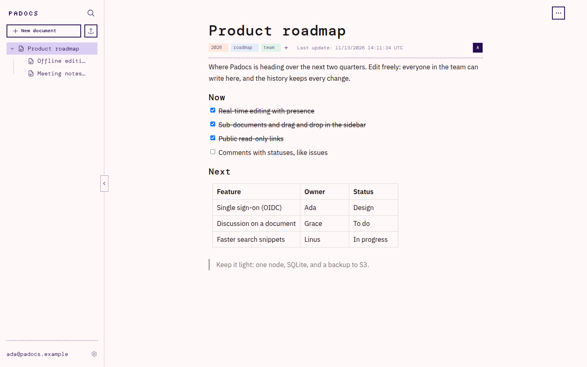
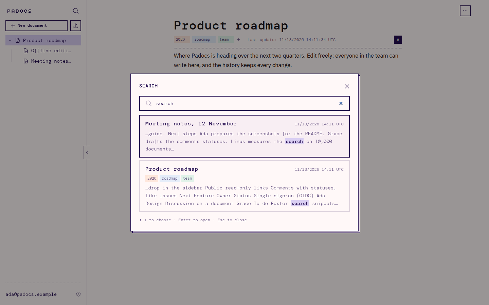
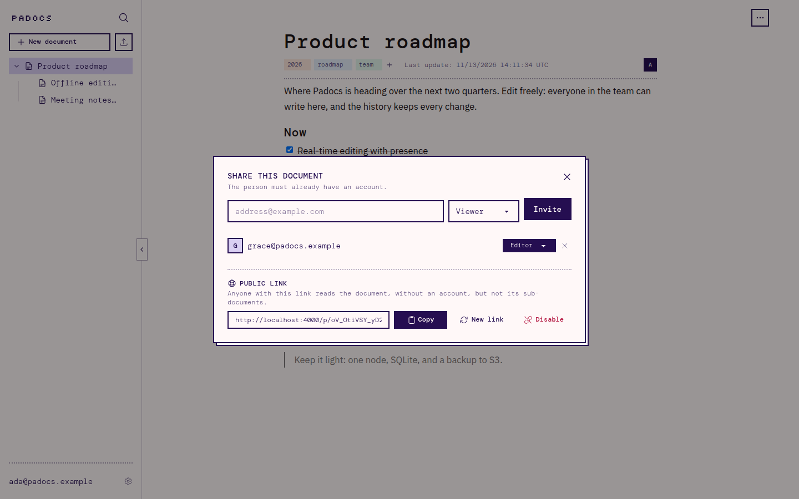
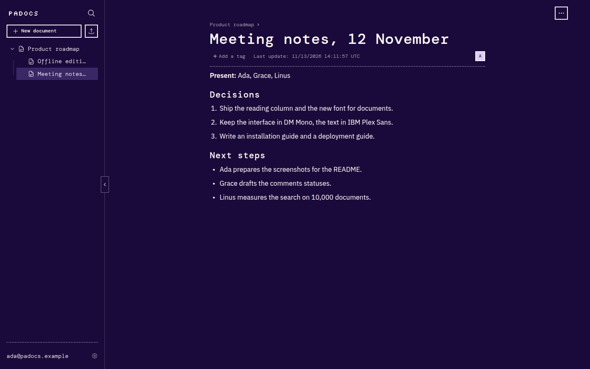

# Padocs

**Collaborative documents that are light to host.** Write together in real
time, organize documents in a tree, find them with full-text search, and share
them with your team or with a public link. It all runs as a single Elixir
application next to a SQLite file.



## Why Padocs

[La Suite numérique's Docs](https://github.com/suitenumerique/docs) is a great
collaborative editor, but hosting it yourself means running a Django backend,
a Next.js frontend, a Node server for the real-time collaboration, PostgreSQL,
Redis, S3 storage and an OIDC provider. That is a lot for a team, an
association or a small organization that just wants to write together.

Padocs keeps what makes Docs pleasant, the [BlockNote](https://www.blocknotejs.org)
editor and [Yjs](https://yjs.dev) for conflict-free collaboration, and puts
everything else in one [Phoenix](https://www.phoenixframework.org) application:

- **One process, one file.** The documents, accounts and history live in a
  SQLite database. [Litestream](https://litestream.io) can stream it to S3,
  so a crash costs about a second of edits.
- **Small machines.** The reference deployment is one shared CPU and 512 MB of
  memory, suspended when no one is connected.
- **Optional extras.** S3 or Bunny Storage for the images, GitHub or GitLab
  sign-in, a remote libSQL database: each one is turned on by a few
  environment variables.

## Features

- **Real-time editing**: everyone's edits and cursors live, with the people
  who have the document open shown next to its title.
- **Offline**: edits made without a connection are kept in the browser and
  merged when it comes back.
- **Sub-documents**: a tree in the sidebar, reordered by drag and drop. Access
  is inherited from the parents.
- **Search**: full-text search with snippets, filters (recent, mine, shared
  with me, trash) and tags.
- **Sharing**: viewer and editor roles per document, and a public read-only
  link for people without an account.
- **History**: every change kept, grouped by minute, then by hour, day and
  week. Any version can be viewed and restored.
- **Trash**: deleted documents come back with their sub-documents.
- **Import and export**: import Markdown, HTML, text and Word files. Export to
  PDF (made with [Typst](https://typst.app)), Word, OpenDocument, Markdown and
  Typst.
- **Images**: pasted or dropped in the editor, stored locally, on S3 or on
  Bunny Storage.
- **Sign-in**: password, a link sent by email, GitHub or GitLab.
- **In French and English**, with a light and a dark theme.

| Search across documents | Share with people or by a link |
|---|---|
|  |  |



## Try it locally

**With Docker**, nothing else to install:

```sh
git clone <this repository> padocs && cd padocs
HOST_UID=$(id -u) HOST_GID=$(id -g) docker compose up --build
```

The first start takes several minutes (it compiles the dependencies, Rust
included); the next ones are quick. The code is mounted in the container:
edit it on your machine, the page reloads.

**Without Docker**, you need Elixir, Rust (the search index is a native
library) and Node.js:

```sh
npm ci --prefix assets
mix setup
mix phx.server
```

Either way, open [localhost:4000](http://localhost:4000) and create an account. The
emails sent while developing are at [localhost:4000/dev/mailbox](http://localhost:4000/dev/mailbox).
See the [local setup guide](docs/local-setup.md) for the details.

## Documentation

- [Local setup](docs/local-setup.md): prerequisites, first run, tests, sign-in
  with GitHub or GitLab, a libSQL database.
- [Deployment](docs/deployment.md): with Docker, on Fly.io with Litestream, on
  Bunny; the environment variables, the storage of images, emails.
- [How it works](docs/how-it-works.md): public links, exports.
- [Performance](docs/performance.md): load tests and their results.
- [To do](TODO.md): what comes next.

## License

Padocs is released under the [MIT license](LICENSE).

The JavaScript served to the browser also bundles BlockNote's "XL" exporters
(`@blocknote/xl-*`), licensed under the GPL-3.0 (or a commercial license):
that bundle as a whole is distributed under the terms of the GPL-3.0, and its
complete source is this repository. BlockNote itself (`@blocknote/core`,
`react`, `mantine`) is under the MPL-2.0.

The fonts in `priv/static/fonts` (DM Mono, IBM Plex Sans, Silkscreen) are under
the SIL Open Font License.
